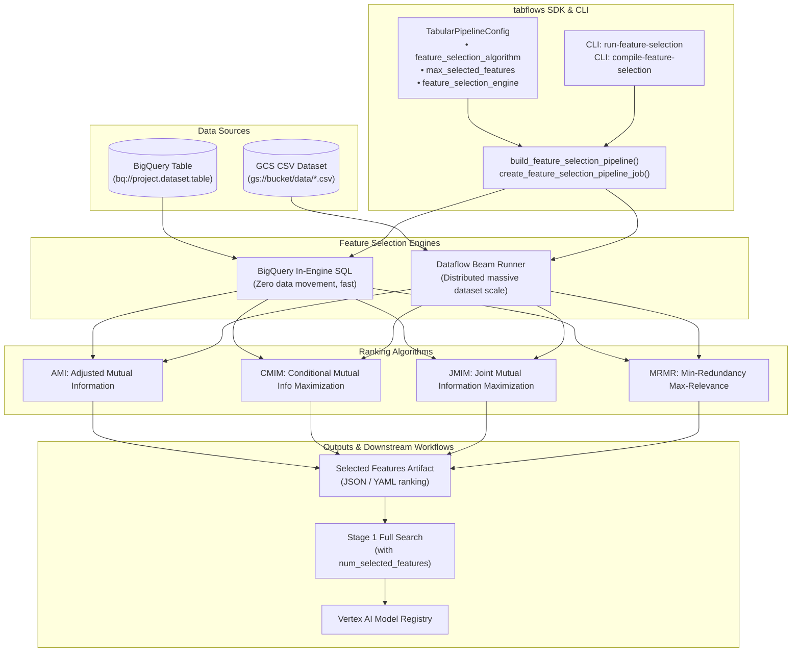

# Implementation Plan: Phase 2 — High-Value Features (Feature Selection & Ranking)

**Author:** Jordan Totten  
**Date:** 2026-09-10  
**Repository:** `tabflows`  
**Status:** READY FOR IMPLEMENTATION  

---

## 1. Executive Summary & Objective

In Phase 1, we successfully hardened the `tabflows` core codebase, refactored skip-evaluation pipeline calls to use first-class GCPC v1 parameters, implemented Probabilistic Inference (`enable_probabilistic_inference`, `quantiles`), added Model Registry metadata (`model_display_name`, `model_description`), and enterprise infrastructure controls (`dataflow_service_account`, Dataflow/Batch Evaluation worker scaling). All 84 tests pass with full type safety (`ty check`) and linting (`ruff`).

Phase 2 focuses on adding **Feature Selection & Feature Ranking** capabilities to `tabflows`. In real-world enterprise tabular datasets (e.g. adtech, genomics, fraud, banking, telemetry), datasets often have hundreds or thousands of raw features. Training full search ensembles across thousands of redundant features degrades generalization, balloons training budget hours, and introduces prediction latency. 

Using Google Cloud's `google_cloud_pipeline_components.preview.automl.tabular.utils.get_feature_selection_pipeline_and_parameters` and the integrated v2 AutoML Tabular pipeline (`num_selected_features`), `tabflows` will provide:
1. **Standalone Feature Selection Pipeline**: Rapidly rank and select top $K$ features using information-theoretic algorithms (`AMI`, `CMIM`, `JMIM`, `MRMR`) running on serverless BigQuery SQL or Apache Beam on Dataflow.
2. **Integrated End-to-End AutoML Feature Selection**: Automatically filter down features as part of the full search pipeline via `num_selected_features` and `apply_feature_selection_tuning`.
3. **First-class SDK, CLI, and Experiment Logging**: High-level builder functions, CLI subcommands (`run-feature-selection`, `compile-feature-selection`), and experiment logging for selected feature rankings.
4. **Hands-On Tutorial Notebook 11**: `notebooks/11_feature_selection_and_ranking.ipynb` demonstrating high-dimensional feature filtering, comparative ranking between BigQuery and Dataflow engines, and feeding selected subsets into Stage 1 AutoML training.

---

## 2. Technical Architecture & Component Analysis

### 2.1 Google Cloud Pipeline Components (GCPC) Reality
- **GCPC Module**: `google_cloud_pipeline_components.preview.automl.tabular.utils.get_feature_selection_pipeline_and_parameters`
- **Supported Selection Algorithms**:
  - `AMI` (Adjusted Mutual Information)
  - `CMIM` (Conditional Mutual Information Maximization)
  - `JMIM` (Joint Mutual Information Maximization)
  - `MRMR` (Minimum Redundancy Maximum Relevance)
- **Supported Engines**:
  - `'bigquery'`: Recommended when data resides in BigQuery. Zero data egress, lower latency, leverages BigQuery distributed compute.
  - `'dataflow'`: Recommended for CSV sources in GCS or custom complex feature transformations requiring Apache Beam.
- **Pipeline Parameters Accepted**:
  `root_dir`, `project`, `location`, `target_column`, `prediction_type`, `optimization_objective`, `run_feature_selection`, `feature_selection_algorithm`, `feature_selection_execution_engine`, `max_selected_features`, `data_source_csv_filenames`, `data_source_bigquery_table_path`, `bigquery_staging_full_dataset_id`, `predefined_split_key`, `stratified_split_key`, `training_fraction`, `validation_fraction`, `test_fraction`, `weight_column`, `dataflow_machine_type`, `dataflow_max_num_workers`, `dataflow_disk_size_gb`, `dataflow_subnetwork`, `dataflow_use_public_ips`, `encryption_spec_key_name`, `stage_1_deadline_hours`, `stage_2_deadline_hours`.

---

## 3. Detailed Work Breakdown & Implementation Tasks

### Task 1: Configuration Extensions (`src/tabflows/config.py`)
- Add fields to `TabularPipelineConfig`:
  - `feature_selection_algorithm: str | None = Field(default=None, description="Feature selection algorithm: AMI, CMIM, JMIM, MRMR")`
  - `feature_selection_engine: str = Field(default="bigquery", description="Execution engine for feature selection: 'bigquery' or 'dataflow'")`
  - `max_selected_features: int | None = Field(default=None, description="Maximum number of features to select in standalone pipeline")`
  - `num_selected_features: int | None = Field(default=None, description="Number of features to filter down to during Stage 1 AutoML training")`
  - `apply_feature_selection_tuning: bool | None = Field(default=None, description="Whether to tune feature selection hyperparameters in Stage 1")`
  - `bigquery_staging_full_dataset_id: str | None = Field(default=None, description="BigQuery dataset for intermediate staging tables")`
- Add validation:
  - Validate `feature_selection_algorithm` is one of `{"AMI", "CMIM", "JMIM", "MRMR"}` or `None`.
  - Validate `feature_selection_engine` is either `"bigquery"` or `"dataflow"`.

### Task 2: Core SDK Pipeline Builders (`src/tabflows/pipeline.py`)
- Implement `build_feature_selection_pipeline(config: TabularPipelineConfig) -> tuple[str, dict[str, Any]]`:
  - Imports `google_cloud_pipeline_components.preview.automl.tabular.utils as preview_tabular_utils`.
  - Maps configuration parameters:
    - `root_dir`: `f"{config.bucket_uri}/feature_selection"`
    - `project`: `config.project_id`
    - `location`: `config.location`
    - `target_column`: `config.target_column`
    - `prediction_type`: `config.prediction_type`
    - `optimization_objective`: `config.optimization_objective`
    - `feature_selection_algorithm`: `config.feature_selection_algorithm`
    - `feature_selection_execution_engine`: `config.feature_selection_engine`
    - `max_selected_features`: `config.max_selected_features`
    - `data_source_csv_filenames`: `config.csv_file_path`
    - `data_source_bigquery_table_path`: `config.bigquery_table_path`
    - `bigquery_staging_full_dataset_id`: `config.bigquery_staging_full_dataset_id`
    - `stratified_split_key`, `predefined_split_key`, `weight_column`, Dataflow scaling parameters.
- Implement `create_feature_selection_pipeline_job(config: TabularPipelineConfig, credentials: Any | None = None, log_experiment: bool = True) -> aiplatform.PipelineJob`:
  - Compiles the template, builds parameter dictionary, initializes `aiplatform.PipelineJob` with `AnonymousCredentials` fallback.
  - Optionally logs run to Vertex AI Experiments.
- Update `build_automl_tabular_pipeline` to forward `num_selected_features` and `apply_feature_selection_tuning` to `get_automl_tabular_pipeline_and_parameters`.
- Export `build_feature_selection_pipeline` and `create_feature_selection_pipeline_job` in `src/tabflows/__init__.py`.

### Task 3: CLI Subcommands & Options (`src/tabflows/cli.py`)
- Add CLI options to `run-pipeline` and `compile-pipeline`:
  - `--num-selected-features`: Target feature count for training.
  - `--apply-feature-selection-tuning`: Enable tuning of feature selection threshold.
- Add new CLI subcommands:
  - `tabflows run-feature-selection`: Submits a Vertex AI Feature Selection PipelineJob.
  - `tabflows compile-feature-selection`: Compiles the Feature Selection PipelineJob to JSON without cloud submission.
  - Options: `--algorithm [AMI|CMIM|JMIM|MRMR]`, `--engine [bigquery|dataflow]`, `--max-selected-features INT`, `--staging-dataset STR`, plus common data source and project flags.

### Task 4: Comprehensive Test Suite Additions
- `tests/test_config.py`:
  - Test validation of `feature_selection_algorithm`, `feature_selection_engine`, and integer counts.
- `tests/test_pipeline.py`:
  - Test `build_feature_selection_pipeline` returns valid template and parameter values for BigQuery and Dataflow engines.
  - Test `create_feature_selection_pipeline_job` initializes `aiplatform.PipelineJob` with correct display name and credentials.
  - Test `build_automl_tabular_pipeline` correctly passes `num_selected_features` and `apply_feature_selection_tuning`.
- `tests/test_cli.py`:
  - Test `compile_feature_selection` CLI command with various algorithm flags.
  - Test CLI parameter parsing for `--num-selected-features`.

### Task 5: Tutorial Notebook 11 (`notebooks/11_feature_selection_and_ranking.ipynb`)
- **Cell 0 (Markdown)**: Title, rationale for feature selection in enterprise workflows, algorithm trade-offs (AMI vs. CMIM vs. MRMR).
- **Cell 1 (Code)**: Environment setup and imports (`tabflows.TabularPipelineConfig`, `tabflows.create_feature_selection_pipeline_job`, `tabflows.create_tabular_pipeline_job`).
- **Cell 2 (Code)**: Configuration for Standalone Feature Selection using BigQuery engine and `MRMR` algorithm with `max_selected_features=15`.
- **Cell 3 (Code)**: Compile and inspect Standalone Feature Selection PipelineJob.
- **Cell 4 (Code)**: Configuration for Stage 1 AutoML Full Search with embedded feature selection (`num_selected_features=15`, `apply_feature_selection_tuning=True`).
- **Cell 5 (Code)**: Compile Stage 1 Full Search with embedded feature selection.
- **Cell 6 (Code)**: Summary table comparing feature selection strategies and cost/runtime impacts.
- Execute notebook to populate all cell outputs.

### Task 6: Documentation & Topic Notes
- Update `README.md`:
  - Document Feature Selection pipelines and ranking algorithms.
  - Document CLI commands `run-feature-selection` and `compile-feature-selection`.
  - Add Notebook 11 to tutorial directory list.
- Update `docs/notes/README.md` and create `docs/notes/11_feature_selection_and_ranking.md` (keep index under 200 lines).
- Verify full verification suite: `uv run pytest`, `uv run ty check src/`, `uv run ruff check .`, `uv build`.

---

## 4. Execution Plan & Risk Management

| Phase | Milestone | Risk / Mitigation |
|---|---|---|
| **Step 1** | Configuration & Validation (`config.py`) | Low risk. Pydantic validator prevents invalid algorithm strings. |
| **Step 2** | Pipeline Builder (`pipeline.py`) | Medium risk. Ensure `preview.automl.tabular.utils` imports gracefully and handles unauthenticated `AnonymousCredentials` in CI. |
| **Step 3** | CLI Commands (`cli.py`) | Low risk. Follow Click decorator conventions established across `run_automl` and `run_skip_evaluation`. |
| **Step 4** | Test Suite Coverage (`tests/`) | Low risk. Mock GCP API calls and verify dictionary key presence. |
| **Step 5** | Notebook 11 Authoring & Execution | Low risk. Use local execution script to populate notebook outputs offline. |
| **Step 6** | Documentation & Verification | Low risk. Strict `ruff`, `ty`, and `pytest` checks. |

---

## 5. Review Checkpoints
- **Checkpoint A**: Verify `preview.automl.tabular.utils` parameter mapping matches exact pipeline component specifications.
- **Checkpoint B**: Verify CI test suite passes in headless/unauthenticated environments without GCP credentials.
- **Checkpoint C**: Verify notebook cleanly compiles without live GCP billing charges.
